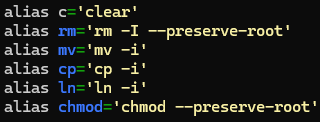

## Course Introduction

The course **Command Line Tools for Linguists** teaches the essentials of working in a command-line environment, with special focus on tasks related to language technology. This includes learning to use basic tools for scripting, text processing and software management in a UNIX-like environment. The course utilizes blended teaching with emphasis on self-study that is supported by lecture videos, tutorials and quizzes, along with one in-person support session per learning module.

The course consists of four modules and a final project. I will briefly describe their main contents and reflect on what I learned from them in the following summary.

## Course Contents Summary

### Module 1: Introduction to Command Line Environments

In the first module, we installed **command-line environments** on our computers and learned how to navigate the file system via some basic commands. We also learned some terminal-based commands for text editing as well as how to check and adjust **file permissions**.

I had never navigated a command-line environment before, so practically everything in this module was new to me. I felt blind as a bat while moving around, so I got used to spamming the `ls` command constantly. It was very interesting and fun to learn how to traverse and handle a text-based file system, however, and by the end of the module, I wasn’t quite as intimidated by UNIX-like environments anymore!

#### Top 5 commands I learned:

| **COMMAND**	| **FUNCTION**						| **EXAMPLE**			|
|---------------|-------------------------------------------------------|-------------------------------|
| `ls`		| list contents (of directory)				| `ls -alF`			|
| `cd`		| change directory	  				| `cd /home/user`		|
| `cat`		| print contents of argument file(s) on the terminal	| `cat notice.txt`		|
| `nano`	| open nano text editor					| `nano notes.txt`		|
| `chmod`	| change file and directory permissions			| `chmod 600 my-secrets.txt`	|

### Module 2: Text Processing in UNIX

In the second module, we learned how to use **text processing tools** in UNIX, which was supported by learning about character encodings, formatted text files and building command pipelines. Out of command-line commands, `grep` and `sed` took the spotlight.

I learned the basics of using **regular expressions** during this module, which will serve me well in future programming courses. I’m also fairly confident in using `grep` or `egrep` now, but `sed` and its many, _many_ uses still tend to confuse me, so I’m going to need to look into `sed` more after this course.

#### Here’s a command pipeline I learned:
`cat filename.txt | tr -s '\n\r\t  ' '\n' | tr -dc "[:alnum:]\n" | sort | uniq -c | sort -nr >filename.freq`

This is a rudimentary command pipeline for creating a frequency list based on a text file.  
The command
1. reads a specified file
2. replaces newlines, carriage returns, tabs and spaces with a single newline (while squeezing repeated characters) --> effectively creates a word list (one word per line)
3. deletes all instances of "words" that DON'T consist of letters `[a-zA-Z]` or numbers `[0-9]` from the word list
4. sorts the words in alphabetical and numerical order
5. prints the words with duplicates taken out, adding the number of times the word was repeated as a prefix
6. sorts the words according to reverse numerical value (greatest prefix to smallest), then saves the lines to a FREQ file

While the pipeline could use more work, as for example it doesn't take words with dashes (-) or apostrophes (') into consideration, it's a great demonstration of how powerful chaining commands containing regex can be!

### Module 3: Scripting, Configuration Files and Installing Programs

In the third module, we started off by learning to tidy up our command pipelines into simple **scripts** that utilize Bash variables. We also learned to adjust our **configuration files** and run commands as the **root user** (via `sudo` and `su` commands). Finally, we practiced installing software using `apt-get` or `brew` and python packages using `pip`, both system-wide as well as in Python virtual environments.

This module’s beginning was somewhat familiar territory to me, since I recently started learning Python. While the variables and requirements for creating runnable Bash scripts were a little different compared to what I’m used to, I was happy to see that `if` statements and `while` loops were basically the same.

I also struggled a bit with making changes to my configuration file due to my novice Bash reading skills, as my customizations kept messing up my Bash prompt. I did, however, at least manage to create some useful aliases for shortcutting commands and making fail-safes for accidental deletion or overwriting! (see picture on the right)

As for what comes to using `sudo` and especially `pip` commands… I felt as if I had about a 30 to 40 percent success rate with those. I did at least receive comfort from the [_Universal Install Script_ comic](https://www.explainxkcd.com/wiki/index.php/1654:_Universal_Install_Script), which illustrates how most of humanity seems to hold the same unfortunate curse.

### Module 4: Using ssh, scp and Version Control
In the fourth module, we first learned how to identify and manage processes. We then learned how to connect to a **remote server** through practicing using the `ssh` and `scp` commands on CSC’s Roihu remote server. Finally, we learned about **version control** using **Git** and **GitHub repositories**.

#### Here’s a basic idiot-proof command chain I’ve made for myself for when I’m working in a repo branch:

| COMMAND			| FUNCTION											| ADDITIONAL NOTES				|
|-------------------------------|-----------------------------------------------------------------------------------------------|-----------------------------------------------|
| `git pull origin main`	| download + integrate any changes that have been made into the repo (HEAD) since the last pull	| *Remember to use in group projects!		|
| `git add -A`			| add _all_ pending changes to the file contents into the Git staging area			| *If just 1 file --> `git add <FILE>`		|
| `git status`			| check current state of the Git repo & staging area						| *Check if additions are OK!			|
| `git commit -m "MSG"`		| save a snapshot of _previously staged_ changes to the repo with a specified message		| *Be descriptive with your messages!		|
| `git push origin main`	| publish local changes to the remote repo							| *Can be undone safely with `git revert <SHA>`	|

### Final project: Jekyll and GitHub Pages

For our final assignment, we were tasked with building a webpage using **GitHub Pages**. This required us to use our previously learned Git and GitHub repo skills, combined with learning basic **Markdown** formatting and using the static site generator **Jekyll** to view our webpage’s progress locally before committing our edits to GitHub. We were also tasked with creating a CV on Overleaf by using one of the available LaTeX templates there.

Although I started building this webpage a bit late and therefore had to hurry some things, I’ve learned a surprising amount in such a short time. I had no idea that creating and finding a host for your own webpage could be this simple! GitHub Pages is definitely something I will be using together with GitHub repositories in the future. The same goes for creating a CV from pre-existing and highly customizable templates on Overleaf. I luckily have some previous background in HTML and CSS coding, so I found both LaTeX templates as well as Markdown quite intuitive to work with.

Jekyll was also a delightful tool to work with. Not only did it allow me to check how my coding attempts look before I push my blunders into my repo for everyone to see, but the ready Jekyll themes for web page customization were also incredible timesavers in terms of formatting (based on my hazy memories of creating even simple webpages from scratch). I was also impressed by how seamlessly the `bundle exec Jekyll serve` command worked for frequent page layout checks. Not a single error message in sight, I felt almost blessed after all of my previous compatibility issues when working on my WSL.

All in all, I might have gone a bit overboard with creating the webpage and CV for my muse (Pura is still sitting next to me, watching over my work), but at least this final project will definitely stay in my memory. It definitely reminded me why I liked webpage coding (even if it was just in Notepad) in lower secondary school, and how I can actually have fun when making projects too!
