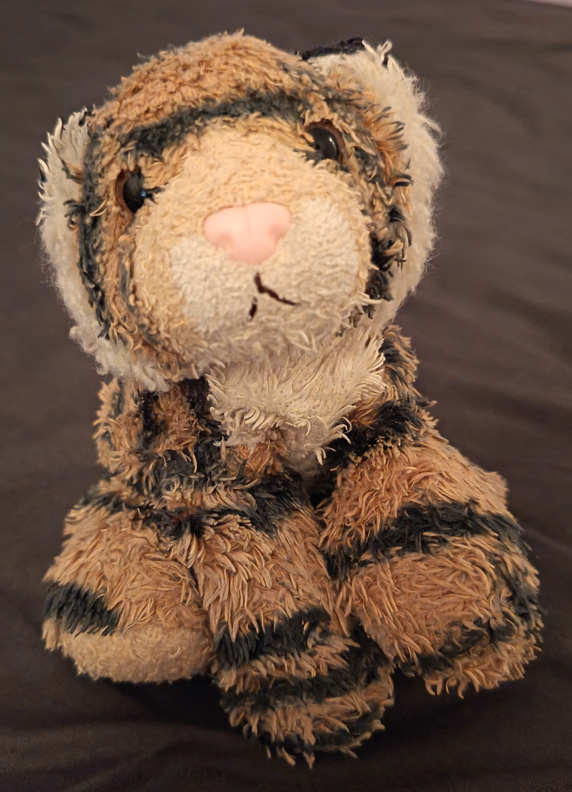

## Introduction

 Hello! I'm Pura Tigger <small>(not related to the esteemed Tigger living in the Hundred Acre Wood).</small>  
I'm a stay-at-home/travel plush that has 20 years of experience working as an emotional support tigger, both in Finland as well as abroad.

Although I like my current job, I aspire to double-major as a "rubber duck" to assist human programmers with my debugging expertise. That's why I sometimes hitch a ride with my charge to the University of Helsinki, where I listen in on various lectures.  
I'm already interning as an amateur rubber duck by tutoring my charge in programming.

In my free time, I like watching action movies with my family or ghostplaying video games.  
My favorite game is CTR Nitro-Fueled, which has my favorite quote of all time:
>**_rwaAAAargh!!!_** –Pura (my namesake!), 2019

## Find me on

* [GitHub](https://github.com/krmakela) (contribution: mascot + debugging support)

* **LinkedIn** (under construction)

## Contact

I don't have an email, but if you _really_ want to contact me, you can reach me through my agent!  
Her email address is of the form first_name.middle_name_initial.last_name@helsinki.fi.

## Courses I've Taken

* [Introduction to Programming](https://studies.helsinki.fi/courses/course-unit/otm-5b481a9e-2ca4-4131-baab-58eb384bed41), summer 2026 (MOOC)

* [Command Line Tools for Linguists](https://studies.helsinki.fi/courses/course-unit/otm-c13d30ee-e5cc-4e1c-b8b3-67883288b9a4), fall 2026

## Future Courses

* [Advanced Course in Programming](https://studies.helsinki.fi/courses/course-unit/otm-eb53011c-6248-419c-84e7-5382982a6b9b), fall 2026 (period 2)

## Projects

* [First GitHub Repo](https://github.com/krmakela/cmdline-course)

   I oversaw my tutee's homework project of creating her first test repository on GitHub.

## Misc. 

* [My favorite game](https://en.wikipedia.org/wiki/Crash_Team_Racing_Nitro-Fueled)

* [Inspiring quotes](https://www.youtube.com/watch?v=s_EmO-WHkk0)
